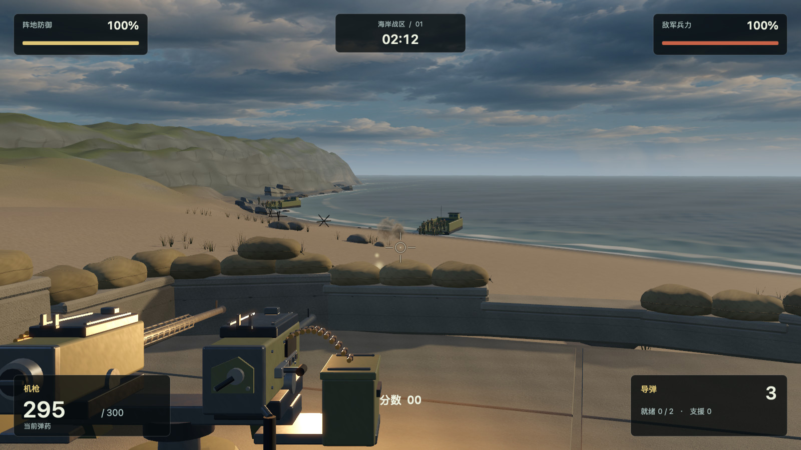
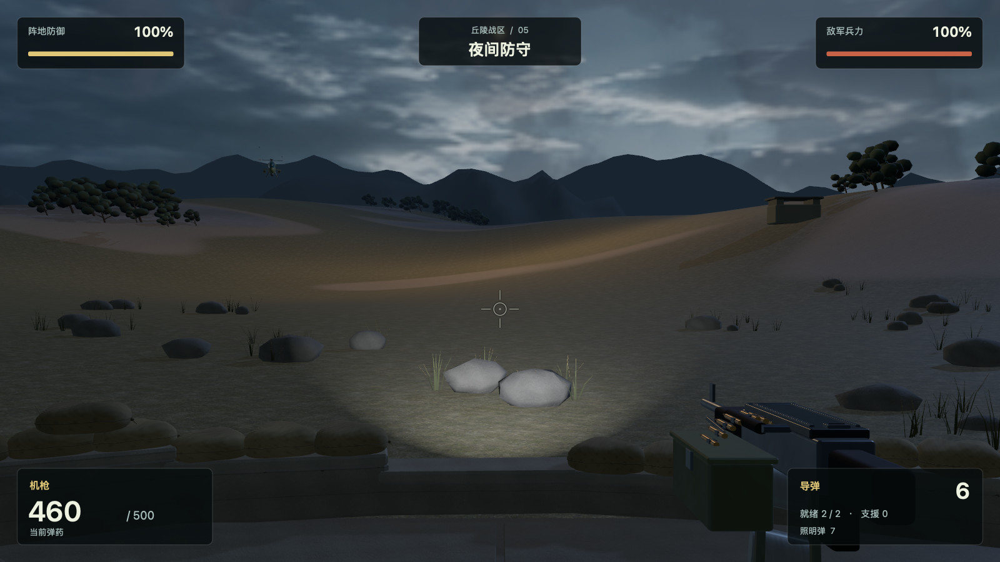
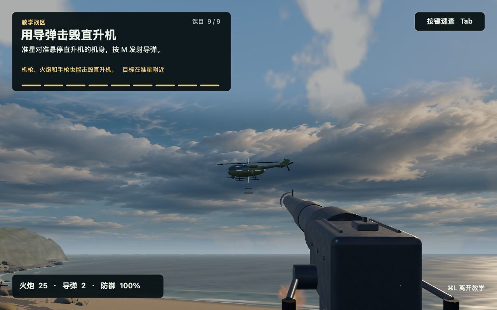

<a id="english"></a>

# Depthline · 纵深防线

**English** · [简体中文](#chinese)

**[Download Depthline v0.8.5 for Mac (.dmg)](https://github.com/FourthBeam/Depthline/releases/download/v0.8.5/Depthline-v0.8.5-macOS-arm64.dmg)** · Requires an Apple Silicon Mac running macOS 13 or later.

Open the downloaded DMG, drag **Depthline.app** into **Applications**, then open the game from Applications. No build tools or compilation are needed.

This build uses an ad hoc signature and hasn’t been notarized by Apple. If macOS says it can’t verify the developer on first launch, see [Apple’s guide to opening downloaded apps](https://support.apple.com/en-us/102445).

Depthline is a first-person defense game for Apple Silicon Macs. Hold your ground at a fixed gun emplacement: use the machine gun against infantry, the cannon against armor, and missiles against aircraft. Watch for supply drops to replenish your ammunition. Version **0.8.5** includes three sectors—Training, Coast, and Hills—and supports 12 interface languages, including English, Simplified Chinese, and Traditional Chinese.

## Gameplay screenshots

**Coast — Landing craft approach the beach as the coastal machine gun opens fire.**



| Hills — Defending the position at night | Training — Lining up a missile shot on a helicopter |
| --- | --- |
| [](docs/screenshots/hills-night.jpg) | [](docs/screenshots/training.jpg) |

[Supply markings](docs/screenshots/supply-markings.png): a red cross restores health, three cartridges give machine-gun rounds, a shell gives cannon rounds, and a finned missile gives missiles. The designs are painted on all four sides of the crate.

## Build from source

You need an Apple Silicon Mac running macOS 13 or later, Python 3, and Xcode Command Line Tools with a Swift compiler that supports the project sources. The game uses Apple's AppKit, SceneKit, and Metal frameworks. To install the command line tools for the first time, run `xcode-select --install`.

Double-click **启动纵深防线.command** in the project folder. On the first run, the launcher builds the game before opening it. You can also build and launch it from Terminal:

```sh
bash native/build.sh
open build/Depthline.app
```

The build generates the terrain and packages the mission configurations, images and synthesized audio included in the repository. To regenerate the audio, run `python3 tools/generate_original_audio.py` in a Python environment with NumPy installed.

## How to play

The game opens with Training selected. Follow the firing-range prompts to practice aiming, switching weapons, collecting supplies, calling in Coast artillery (A) and a Hills bomber strike (B), and firing missiles. Coast has 60 distinct missions and Hills has 99. Both campaigns end after their final mission; the result is saved and you can return to sector selection. Each campaign creates a checkpoint at the start of a mission. The last hit locks in your score, and the victory menu waits for the crash, explosion and other effects to finish. After an intermediate win, you can continue to the next mission or return to sector selection. Progress, named saves, and settings are stored locally in `~/Library/Application Support/Depthline/campaigns.json`.

| Action | Control |
| --- | --- |
| Capture or release the mouse | F8 or Control + Option + M |
| Aim / fire | Move the mouse / left-click |
| Cycle primary weapons / switch to the pistol | Space / G |
| Launch a missile / fire a flare at night | M / F |
| Call in support | A in Coast / B in Hills |
| Pause or resume | Esc or P |
| Toggle full screen | Control + Command + F |

Use the gear in the upper-right corner to adjust display, sound, language, and mouse sensitivity. To see the available cheat codes and their effects, pause a battle, open Settings, and click the question mark beside the code field. Both the power button beside the gear and **Quit the game** in the pause menu ask for confirmation before closing the game.

## Run the checks

Run these commands from Terminal while logged in to a macOS graphical desktop. The first checks campaign data, asset loading, and the simulation in selected missions. The second checks the menus, training sequence, cheat codes, and quit confirmation. Both use temporary saves.

```sh
./build/Depthline.app/Contents/MacOS/Depthline --depthline-test --depthline-report build/checks/game/validation.json
./build/Depthline.app/Contents/MacOS/Depthline --menu-test --menu-output build/checks/menu
```

## Asset sources and noncommercial use

This project is for learning, research, and noncommercial exchange. Commercial use requires separate permission from the relevant rights holders. The credits display the FourthBeam and Codex marks. The developer supplied the FourthBeam mark, and the Codex mark comes from the OpenAI desktop app. The marks belong to their respective rights holders.

The terrain, collision data, and 3D models are generated procedurally. Coast and Hills use the enemy slots, activation delays, aircraft payloads and aggression values recovered from the supplied Beach Head 2000 and 2002 mission data. Starting ammunition and support calls follow each original mission. The Coast countdown determines a time bonus; Hills has no mission countdown. Gunfire, explosions, and menu music are synthesized from oscillators and noise. Generative tools were used to create the ground textures, skies, visual effects, menu illustrations, and app icon. Parts of the gameplay simulation and internal compatibility interfaces draw on earlier research.

The [tools directory](tools/) contains the generation scripts. The [art asset manifest](remastered-assets/manifest.json), [cloud generation record](original-assets/sky-generation.json), and [audio manifest](original-assets/audio/manifest.json) document the assets. The built app lists its bundled resources and their SHA-256 hashes in `Contents/Resources/ASSET-PROVENANCE.json`.

---

<a id="chinese"></a>

[English](#english) · **简体中文**

# 纵深防线 · Depthline

**[下载《纵深防线》v0.8.5 Mac 版（DMG）](https://github.com/FourthBeam/Depthline/releases/download/v0.8.5/Depthline-v0.8.5-macOS-arm64.dmg)** · 适用于搭载 Apple 芯片、运行 macOS 13 或更高版本的 Mac。

打开下载的 DMG，把 **Depthline.app** 拖入「应用程序」文件夹，再从中打开游戏。无需安装开发工具或自行编译。

此版本使用本机临时签名，未经 Apple 公证。如果首次打开时 macOS 提示无法验证开发者，请参阅 [Apple 的说明](https://support.apple.com/zh-cn/102445)。

《纵深防线》是一款面向 Apple Silicon Mac 的第一人称定点防御游戏。你在固定炮位上守住阵地，用机枪拦截步兵、火炮压制装甲、导弹对付空中目标，并通过空投补充弹药。当前版本为 **0.8.5**，包含教学、海岸和丘陵三个战区，支持简体中文、繁体中文、英语等 12 种界面语言。

## 实机画面

**海岸战区 · 登陆艇靠岸，岸防机枪迎击登陆部队。**


| 丘陵战区 · 夜间阵地防守 | 教学战区 · 锁定直升机，练习发射导弹 |
| --- | --- |
| [](docs/screenshots/hills-night.jpg) | [](docs/screenshots/training.jpg) |

[空投标志图例](docs/screenshots/supply-markings.png)：红十字是回血箱，三发子弹是机枪弹，单枚炮弹是炮弹补给，带尾翼的导弹是导弹补给。图案印在箱子四面，伞面保持原样。

## 从源码构建

需要 Apple Silicon Mac、macOS 13 或更高版本、支持当前 Swift 源码的 Xcode 命令行工具，以及 Python 3。游戏使用系统的 AppKit、SceneKit 和 Metal。首次安装开发工具可运行 `xcode-select --install`。

在项目目录双击 **启动纵深防线.command**，首次运行会先编译。也可以在终端执行：

```sh
bash native/build.sh
open build/Depthline.app
```

普通构建会生成地形，并打包仓库内的关卡配置、图片和合成音频。要重新合成音频，可在安装了 NumPy 的 Python 环境中运行 `python3 tools/generate_original_audio.py`。

## 开始游戏

第一次进入时默认选中教学战区。跟随靶场提示练习瞄准、武器切换、领取补给、呼叫海岸炮击（A）和丘陵轰炸（B），最后练习发射导弹，再进入海岸或丘陵。海岸有 60 份独立关卡配置，丘陵有 99 份。战役在关卡开始时建立检查点。最后一击锁定成绩，等坠毁、爆炸等演出结束后再显示结算菜单。普通关卡可继续下一关或返回战区选择；海岸第 60 关和丘陵第 99 关胜利后结算成绩，返回战区选择。进度、命名存档及设置保存在本机的 `~/Library/Application Support/Depthline/campaigns.json`。

| 操作 | 按键 |
| --- | --- |
| 锁定或释放鼠标 | F8 或 Control + Option + M |
| 瞄准 / 开火 | 移动鼠标 / 鼠标左键 |
| 切换主武器 / 手枪 | 空格 / G |
| 发射导弹 / 夜间照明弹 | M / F |
| 请求战区支援 | 海岸 A / 丘陵 B |
| 暂停或继续 | Esc 或 P |
| 切换全屏 | Control + Command + F |

右上角齿轮可调整显示、声音、语言和鼠标灵敏度。战斗暂停后进入设置，点击秘籍输入框旁的问号可查看口令和效果。右上角的电源按钮和暂停菜单的「退出游戏」都会先请求确认。

## 验证

在已登录 macOS 图形桌面的终端运行以下检查。第一项验证战役、资源加载及选定关卡的模拟，第二项验证菜单、教学流程、秘籍和退出确认。两者均使用临时存档。

```sh
./build/Depthline.app/Contents/MacOS/Depthline --depthline-test --depthline-report build/checks/game/validation.json
./build/Depthline.app/Contents/MacOS/Depthline --menu-test --menu-output build/checks/menu
```

## 素材来源与非商业用途

本项目仅供学习、研究和非商业交流。商业使用需另行取得相关权利人的授权。制作人页面显示 FourthBeam 和 Codex 标识。FourthBeam 标识由开发者提供，Codex 标识来自 OpenAI 桌面应用，相关标识的权利归各自权利人。

地形、碰撞数据和三维模型由程序生成。海岸与丘陵分别采用从《抢滩登陆 2000》和《抢滩登陆 2002》还原的敌方编成、出场延迟、空运载荷和攻击性参数。玩家开局弹药、计时和可呼叫支援也取自对应原版关卡。海岸倒计时影响通关奖金，丘陵没有关卡倒计时。枪炮、爆炸和菜单音乐以振荡器和噪声合成。地表贴图、天空、特效、菜单插画及应用图标使用生成式工具制作。部分玩法模拟与内部兼容接口沿用了早期研究成果。

生成脚本位于 [tools](tools/)，图像记录见[美术素材清单](remastered-assets/manifest.json)和[云层生成记录](original-assets/sky-generation.json)，音频记录见[音频清单](original-assets/audio/manifest.json)。构建后的应用在 `Contents/Resources/ASSET-PROVENANCE.json` 中列出随包资源及其 SHA-256。
